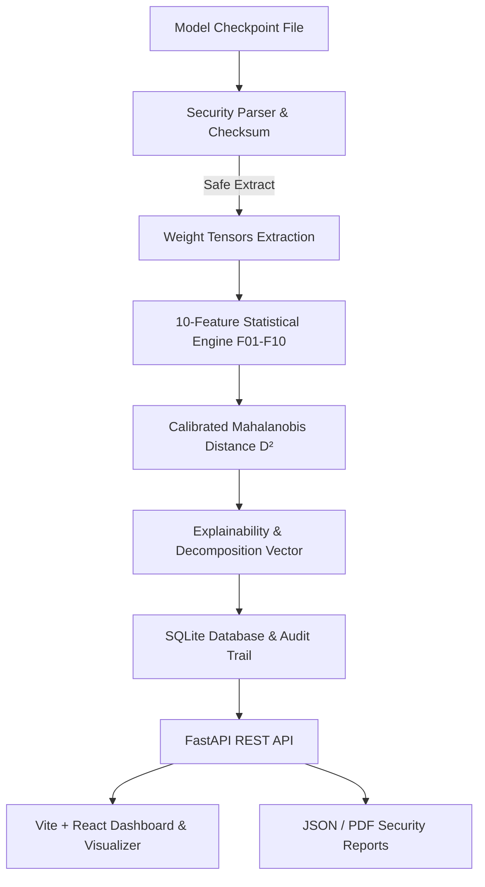

# Neural Guard 🛡️
> **Protecting AI Models, One Weight at a Time.**

[](https://fastapi.tiangolo.com)
[](https://react.dev)
[](https://www.typescriptlang.org)
[](https://www.python.org)
[](LICENSE)

**Neural Guard** is a production-grade, explainable AI model security and weight integrity verification platform. Built on cutting-edge steganography research, Neural Guard inspects deep learning checkpoint files (`.safetensors`, `.pt`/`.pth`, `.onnx`) to identify suspicious statistical anomalies indicating hidden data embedding, malicious steganographic manipulation, or weight-level tampering before model deployment.

---

## 🔬 Scientific & Mathematical Foundation

Neural Guard is an end-to-end implementation of the research framework:
**"Explainable Statistical Detection of Steganographic Manipulation in Neural Network Model Weights: A Multi-Feature Anomaly Detection Framework."**

### The 10 Statistical Feature Extractors (F01 – F10)

For any weight tensor $W \in \mathbb{R}^{d_1 \times \dots \times d_k}$ with IEEE 754 floating-point representations:

| Feature | Name | Mathematical Description | Steganography Signature |
|---|---|---|---|
| **F01** | **LSB Entropy Deficit** | Shannon entropy of least significant mantissa bit-planes $H(b_{\text{LSB}})$. | Natural weights have structured LSB distributions ($H < 1$). Encrypted/random payload injection elevates entropy toward theoretical limit $1.0$. |
| **F02** | **Pairs of Values (PoV)** | $\chi^2$ distance across adjacent integer bin pairs: $\sum \frac{(h_{2i} - h_{2i+1})^2}{h_{2i} + h_{2i+1}}$. | LSB flipping equalizes adjacent bin frequencies, driving $\chi^2 \to 0$. |
| **F03** | **Bit-Plane Bias** | Mean bit frequency $p_k = \frac{1}{N}\sum b_{i,k}$ per mantissa bit position. | Natural weights exhibit distinct exponent/mantissa biases; artificial payloads force $p_k \to 0.5$. |
| **F04** | **Serial Bit Correlation** | Autocorrelation at lag 1: $\rho_1 = \text{Corr}(b_t, b_{t+1})$. | Natural gradient updates preserve sequential smoothness; embedded streams destroy serial correlation. |
| **F05** | **Wald-Wolfowitz Runs Test** | $Z = \frac{R - \mu_R}{\sigma_R}$ test statistic on consecutive identical bit runs. | Non-parametric validation of whether bit sequences follow an independent, identically distributed process. |
| **F06** | **Bit Mutual Information** | $I(b_k; b_{k-1}) = \sum p(x,y)\log\frac{p(x,y)}{p(x)p(y)}$ across adjacent mantissa bit-planes. | Secret payloads decorrelate adjacent bit-planes, causing an abrupt drop in mutual information. |
| **F07** | **Trailing Zero Count** | Proportion of weights with $m \ge k$ trailing zero bits in IEEE 754 mantissa. | Quantized or artificially rounded weights deviate drastically from standard continuous gradients. |
| **F08** | **Zero-Field Fraction** | Proportion of exact IEEE 754 zero floats: $\frac{1}{N}\sum \mathbb{I}[w_i = 0]$. | Pruning and sparsity techniques create structured zeros that payload embedding corrupts. |
| **F09** | **FP16 Lattice Fraction** | Fraction of FP32 values that fall exactly onto the 16-bit half-precision grid. | Detects hidden downscaling and hybrid precision payload hiding. |
| **F10** | **Excess Kurtosis** | Standardized 4th moment: $\kappa = \frac{\mathbb{E}[(W-\mu)^4]}{\sigma^4} - 3$. | Malicious modifications alter weight distribution heavy tails. |

---

### Calibrated Mahalanobis Anomaly Engine

Let $\mathbf{x} = [F_1, F_2, \dots, F_{10}]^\top \in \mathbb{R}^{10}$ be the feature vector extracted from a weight tensor.
Given reference baseline mean $\boldsymbol{\mu}$ and regularized covariance matrix $\boldsymbol{\Sigma} + \lambda \mathbf{I}$:

$$D^2(\mathbf{x}) = (\mathbf{x} - \boldsymbol{\mu})^\top \boldsymbol{\Sigma}^{-1} (\mathbf{x} - \boldsymbol{\mu})$$

Individual feature anomaly contributions are analytically decomposed for transparent explainability:

$$\Delta_i = (x_i - \mu_i) \sum_{j=1}^{10} \Sigma^{-1}_{ij} (x_j - \mu_j)$$

#### Calibrated Decision Boundaries:
- **Normal ($D^2 < 3.00$):** Weights adhere to natural neural network gradient statistics.
- **Suspicious ($3.00 \le D^2 < 5.00$):** Deviations exceed the 95th percentile calibration boundary.
- **High Anomaly ($D^2 \ge 5.00$):** Severe statistical tampering or encrypted payload detected (99th percentile).

---

## 🔒 Security Isolation & Zero-Code Execution Guarantee

Neural Guard treats all uploaded model checkpoints as untrusted binary artifacts:
1. **Safetensors (`.safetensors`):** Parsed using pure binary header extraction without Python object instantiation.
2. **PyTorch (`.pt`, `.pth`):** Loaded exclusively using `torch.load(..., weights_only=True)`. Arbitrary Python unpickling code execution is strictly blocked.
3. **ONNX (`.onnx`):** Tensor matrices extracted via direct Protocol Buffer graph inspection.

---

## ⚡ System Architecture



---

## 🚀 Quickstart & Installation

### Prerequisites
- **Python 3.10+**
- **Node.js 18+** and **npm**

### 1. Backend Setup
```bash
cd backend
pip install -r requirements.txt
uvicorn app.main:app --reload --port 8000
```
Backend API will be accessible at: `http://localhost:8000/api/v1` (Swagger Docs at `/docs`).

### 2. Frontend Setup
```bash
cd frontend
npm install
npm run dev
```
Frontend Web Application will be live at: `http://localhost:5173`.

---

## 🧪 Running Tests & Validation Benchmarks

### Run Backend Feature Unit Tests
```bash
cd backend
python -m pytest tests/ -v
```

### Run Real-time Synthetic Sensitivity Benchmark
From the web UI, navigate to **Settings** → **Empirical Benchmark**, or execute via API:
```bash
curl -X POST http://localhost:8000/api/v1/experiments/run \
  -H "Content-Type: application/json" \
  -d '{"n_clean": 20, "n_embedded": 10, "tensor_shape": [64, 64], "seed": 42}'
```

---

## 📄 License
This project is released under the **MIT License**.
